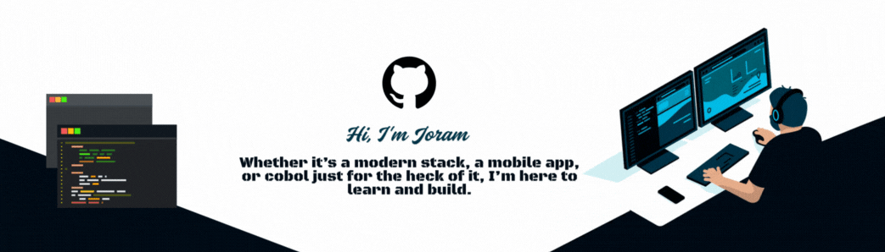
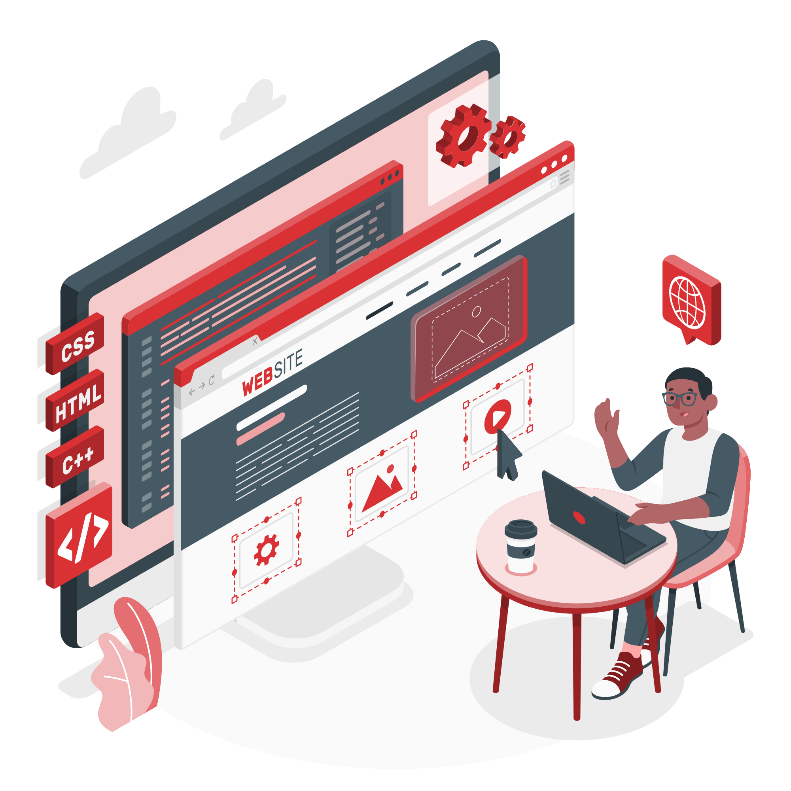
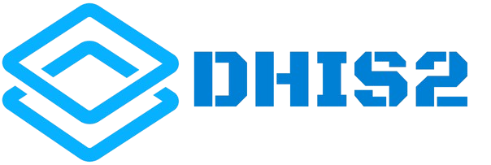

  
  
  
  

  
  
  
  

  <a href="#about">About</a> •
  <a href="#impact">Impact</a> •
  <a href="#stack">Stack</a> •
  <a href="#experience">Experience</a> •
  <a href="#built">Built</a> •
  <a href="#open-source">Open Source</a> •
  <a href="#credentials">Credentials</a> •
  <a href="#stats">Stats</a> •
  <a href="#contact">Contact</a>

 

<h2 id="about">About me</h2>

I'm **Joram Tagny**, a full-stack engineer from **Yaoundé, Cameroon** with **4+ years** of shipping production software for banks, health companies, energy firms and startups across **Africa, Europe and the Middle East**.

Most of what I know came from real work: migrating a legacy airline ticketing platform to **Next.js**, writing a **PEG parser** for airline e-ticket formats, tuning **Salesforce LWC** for **TotalEnergies**, folding a four-service **Java/Spring** stack into a single **Go** service, and taking a production API from **21.5 s to 3 s p95**.

I care about code the next person can read, test and extend without needing to call me.

**Right now I'm:**

- Building **Go & Node.js backends** at **Kimia Technologies**: telemetry, insurance and bank security products
- Shipping full-stack features on **AuditPal**, an enterprise **banking audit** platform
- Building a **geo-referenced partnership platform** for **CAP-CUE** (Cameroon–EU cooperation)
- Building **Bliqo**, social-commerce storefronts in **Rust + React**
- Going deeper on **Go, Rust and cloud infrastructure**

 

 

<h2 id="impact">Impact in numbers</h2>

<table>
  <tr>
    <td align="center" width="33%"><h3>21.5s → 3.07s</h3>p95 response time on FPL Insights (0% errors on a 15-min soak test)</td>
    <td align="center" width="33%"><h3>−50%</h3>production bugs on TotalEnergies' Salesforce platform</td>
    <td align="center" width="33%"><h3>~80%</h3>less Redis memory & bandwidth via transparent gzip caching</td>
  </tr>
  <tr>
    <td align="center"><h3>+60%</h3>dev velocity after migrating AirBooks to Next.js + TypeScript</td>
    <td align="center"><h3>95% / 90%</h3>test coverage: Apex (TotalEnergies) and Jest (WiiQare)</td>
    <td align="center"><h3>4 → 1</h3>Java microservices consolidated into one Go service with zero-downtime cutover</td>
  </tr>
</table>

 

<h2 id="stack">Tech stack</h2>

<table width="100%">
  <tr>
    <td rowspan="8" width="36%" align="center" valign="middle">
      <picture>
        <source media="(prefers-color-scheme: dark)" srcset="./assets/Skills_Animation_Dark.gif">
        <source media="(prefers-color-scheme: light)" srcset="./assets/Skills_Animation_White.gif">
        
      </picture>
    </td>
    <td><b>Languages</b></td>
    <td> + Apex, SOQL, SQL</td>
  </tr>
  <tr>
    <td><b>Frontend</b></td>
    <td> + LWC, Zustand, TanStack Query, ECharts, Recharts, Leaflet</td>
  </tr>
  <tr>
    <td><b>Backend</b></td>
    <td> + Gin/chi/Echo/GORM, Axum, Fastify, Hono, Directus, Strapi, Qt</td>
  </tr>
  <tr>
    <td><b>Mobile</b></td>
    <td> + React Native, offline-first sync (Drift)</td>
  </tr>
  <tr>
    <td><b>Data</b></td>
    <td> + PostGIS, BullMQ, row-level security, DHIS2</td>
  </tr>
  <tr>
    <td><b>DevOps</b></td>
    <td> + Caddy, AWS Amplify, Cloudflare R2, VPS deployments</td>
  </tr>
  <tr>
    <td><b>Quality</b></td>
    <td> + k6 load testing, TDD, OpenAPI, a11y</td>
  </tr>
  <tr>
    <td><b>Platforms</b></td>
    <td>
      
      
      
      
      
      
      
      
      
       + Self-hosted open-source LLMs (Llama, Qwen, DeepSeek via Ollama & Hugging Face) for private, on-premise AI
    </td>
  </tr>
</table>

 

<h2 id="experience">Experience</h2>

  

**4+ years** · **14 organizations** · **Remote across 5 countries**

<i>Banking & Finance • Healthcare • Energy • Government • Media • Logistics • Sports analytics</i>

 

### Now

<b>Kimia Technologies</b>: Backend Developer · <i>May 2026 – Present</i> · Remote, Cameroon

 

Building and modernizing Go and Node.js services across telemetry, insurance and banking security products.

- **Telemetry platform migration (GUM):** rebuilt a four-service Java/Spring Eureka stack (API gateway, auth, site/telemetry) as a **single Go service**, merging two legacy PostgreSQL databases into one schema with idempotent migrations and a **zero-downtime backfill and cutover** runbook.
- **Insurance platform (Kimia Assurance):** building the **Go / chi / GORM** backend for a travel and Takaful insurance platform for Royal Onyx Insurance: quotes, subscriptions, claims, broker commissions, point-of-sale hierarchy, **OCR passport scanning** and on-demand **PDF certificates**.
- **Bank key management (Keylog Center):** NestJS/React monorepo for **Afriland First Bank** that tracks physical keys and credentials across branches with RBAC and an immutable audit trail.
- **E-commerce security audit (Thamani):** audited a Laravel + Vue 3 shop on the Smobilpay mobile-money gateway. Closed a **payment-status bypass** and several **IDOR** holes, enforced webhook signature checks, removed an N+1 query and completed FR/EN localization.
- **Vehicle reservation platform (Kukodi):** Kotlin/Spring Boot microservices + Angular. Unified the Docker deployment behind Nginx/TLS with Flyway migrations and helped scope 2FA, audit logging and mobile-money payments.

`Go` `PostgreSQL` `Redis` `NestJS` `TypeScript` `Kotlin` `Spring Boot` `Laravel` `Vue` `Angular` `Docker`

<b>AuditPal</b>: Full-Stack Developer · <i>Sep 2025 – Present</i> · Remote, Nigeria

 

Full-stack development on an enterprise **banking audit** platform. ([tryauditpal.com](https://tryauditpal.com))

- **Design system from scratch** in React + TypeScript (components, theming, design tokens) with **RBAC** across audit workflows.
- **Financial dashboards** in ECharts/Recharts: banking ratios, trends, variance reports, multi-bank comparisons with drill-down.
- **State at scale** with Redux Toolkit: server-cache sync, optimistic updates, retry logic, skeleton loading.
- **Quality:** Jest + Cypress, a11y, code splitting, Suspense prefetching, CI/CD on GitHub Actions. Recent work includes disposable-email restrictions across auth flows.

`React` `TypeScript` `Redux Toolkit` `ECharts` `Recharts` `Tailwind` `Jest` `Cypress` `GitHub Actions`

<b>CAP-CUE</b> (Cameroon–EU Partnership Unit): Freelance Full-Stack Developer · <i>May 2026 – Present</i>

 

Secure, geo-referenced platform that centralizes the technical and financial tracking of Cameroon–EU cooperation projects.

- Dossier and decision tracking with a **KPI dashboard** (financial envelope vs. disbursed EUR) and role-restricted financial data.
- **Leaflet maps** with regional filtering of interventions across Cameroon.
- Team calendar with **ICS export/sync**, email notifications (Resend), web push and roster management.
- **Migrated years of legacy program data** into a new relational schema; registry export tooling; JWT + RBAC.

`React` `TypeScript` `Fastify` `Prisma` `PostgreSQL` `Leaflet` `TanStack Query` `Zustand`

<b>CMMCameroun</b>: Freelance Full-Stack Developer · <i>Apr 2024 – Present</i>

 

- High-performance **JAMstack** corporate site on **Astro** with sub-second loads and strong SEO. ([cmmcameroun.com](https://cmmcameroun.com))
- **Directus** headless CMS so non-technical staff manage structured content on their own.

`Astro` `Directus` `JAMstack` `SEO`

<b>Telegram</b>: Content Moderator · <i>Sep 2024 – Present</i> · Remote, Dubai

 

- Moderation across multiple channels: guideline enforcement, moderation workflows and escalation procedures.
- Engagement analytics, content-format A/B tests and posting-schedule tuning to improve retention.

### Previously

<b>FPL Insights</b>: Backend Performance Engineer · <i>May 2026</i> · via Trust Consulting

 

Overhauled caching and data serving for a Fantasy Premier League analytics platform that fans out to 10–20 upstream API calls per request.

- Four rounds of **k6** load tests (smoke, baseline, soak, spike): **p95 21.52 s → 3.07 s**, **0% errors** on a 50-user 15-minute soak, warm-cache p95 under 1 s.
- Rewrote the **Redis** client with exponential backoff and health tracking, plus a **distributed lock** (SET NX PX) for exactly one rebuild per miss and a **stale-while-revalidate** layer.
- Transparent **gzip** for cached payloads (**~80%** less Redis memory/bandwidth) with a magic-byte prefix for backward compatibility.
- Per-request upstream timeouts and a fixed **AWS Amplify** CI that had been silently falling back to dev defaults.

`k6` `Redis` `Next.js` `TypeScript` `Node.js` `AWS Amplify` `Supabase`

<b>ALAXIONE Solutions e-Santé</b>: Web Developer & Data Specialist · <i>Jan 2026 – May 2026</i>

 

- Responsive, accessible **WordPress** platforms for a digital-health company. ([alaxione.fr](https://alaxione.fr))
- **Python scraping pipelines** that collect, clean and structure web data for business and operational decisions.

`WordPress` `PHP` `Python` `Data Pipelines`

<b>Trust Consulting Sarl</b>: Full-Stack Developer · <i>Oct 2025 – Jan 2026</i>

 

Finalized and launched the **Royal FM** digital radio platform for a client.

- Next.js frontend features focused on performance and UX; **Directus** customized as the editorial CMS.
- API integrations between frontend and backend; debugged and stabilized the codebase for production.

`Next.js` `Directus` `REST APIs` `TypeScript`

<b>NEEMA</b> (AirBooks): Full-Stack Developer · <i>Jul 2022 – Sep 2025</i> · Yaoundé, Cameroon

 

Led the architectural overhaul of **AirBooks**, an airline ticketing management platform, and delivered client projects in Europe and Africa.

- Migrated the legacy frontend to **Next.js + TypeScript**: **~60%** faster development and much easier maintenance.
- **Go microservices** and PostgreSQL schemas tuned for high-throughput ticket processing.
- REST APIs on **Directus** with versioning, rate limiting and **OpenAPI** docs.
- **E-ticket parsing engine** built on **PEG** grammars, automating extraction across multiple airline standards.

`Next.js` `TypeScript` `Go` `PostgreSQL` `Directus` `OpenAPI` `PEG` `Redux` `Tailwind`

**Client projects delivered through NEEMA**

| Client | Role | Period | What I did |
| --- | --- | --- | --- |
| **WiiQare** · South Africa | Frontend Developer | May 2023 – Sep 2025 | Healthcare admin dashboard on Bun + Next.js (MUI + Tailwind); **~90% Jest coverage** with TDD |
| **TotalEnergies** · France | Salesforce Developer | Mar 2023 – Oct 2023 | Refactored LWC and Apex triggers: **−50% production bugs**, **95% Apex coverage** |
| **CAON FED** · Cameroon | WordPress Developer | Apr 2023 – Sep 2023 | Document management system: custom PHP/JS plugins for versioning and permissions |
| **Oeneo** · France | Salesforce Developer | Jan 2023 – Jun 2023 | Apex trigger handlers and service layers, test classes, ongoing maintenance |
| **Deepvision** · France | Qt/C++ Developer | Jan 2023 – Apr 2023 | Qt UIs and C++/Python logic for underwater camera tracking systems |

 

<h2 id="built">Things I've built</h2>

  

**15 products** · **Architecture → backend → web → mobile → deployment → private AI**

<i>Commerce • Education • Faith & community • Agriculture • Logistics • Betting & prediction • Banking AI • Security</i>

 

<table>
  <tr>
    <td width="50%" valign="top">
      <h3>Bliqo</h3>
      
Personal storefronts shared as a single link. Buyers browse, order and review in-app. Built for markets where WhatsApp and Telegram are the main commerce channels, starting with Cameroon. An AI assistant turns a seller's flyer into a ready-made store using self-hosted DeepSeek-OCR.

      
<code>Rust</code> <code>Axum</code> <code>React 19</code> <code>PostgreSQL</code> <code>Redis</code> <code>DeepSeek</code> <code>GitLab CI</code>

    </td>
    <td width="50%" valign="top">
      <h3>OpenCampus</h3>
      
Multi-tenant school management platform for parents, students, teachers and administrators. Go API with PostgreSQL <b>row-level security</b> and versioned migrations, plus web and mobile clients.

      
<code>Go</code> <code>PostgreSQL RLS</code> <code>Redis</code> <code>React</code> <code>Turborepo</code>

    </td>
  </tr>
  <tr>
    <td valign="top">
      <h3>MinistryOS</h3>
      
Multi-tenant church management SaaS: giving, pastoral care, prayer requests, events and contribution imports, with per-module permissions, idempotent imports and an offline-aware PWA.

      
<code>Hono</code> <code>React</code> <code>PWA</code> <code>PostgreSQL</code> <code>Redis</code> <code>Workers</code>

    </td>
    <td valign="top">
      <h3>Gombo</h3>
      
Directory of trusted businesses in Cameroon, with a public site, an admin console and a mobile app. Geo search on PostGIS, background jobs, direct-to-bucket uploads and encrypted PII.

      
<code>NestJS</code> <code>Next.js</code> <code>Flutter</code> <code>PostGIS</code> <code>BullMQ</code> <code>R2</code>

    </td>
  </tr>
  <tr>
    <td valign="top">
      <h3>Farmagia</h3>
      
Offline-first farm operations platform: modular Rust backend, installable React PWA for managers and a Flutter field app with local-first sync. Inventory, harvest and finance as append-only ledgers.

      
<code>Rust</code> <code>Axum</code> <code>React PWA</code> <code>Flutter</code> <code>PostGIS</code> <code>OpenAPI</code>

    </td>
    <td valign="top">
      <h3>VfExpress</h3>
      
Parcel delivery platform with separate customer and rider apps plus an admin console. Live tracking and routing with Google Maps Routes and Places.

      
<code>Flutter</code> <code>Fastify</code> <code>Prisma</code> <code>PostgreSQL</code> <code>Google Maps</code>

    </td>
  </tr>
  <tr>
    <td valign="top">
      <h3>LionBets</h3>
      
Sportsbook and casino platform on ~25 Go microservices (betting, odds, fixtures, bonuses, jackpots, identity, CMS). I contributed services, migrations and contract work as part of the team.

      
<code>Go</code> <code>Echo</code> <code>MySQL</code> <code>RabbitMQ</code> <code>Kubernetes</code> <code>GCP</code>

    </td>
    <td valign="top">
      <h3>EtoilePredict</h3>
      
Prediction platform with a customer app, a private back office and a Go API behind Caddy with automatic TLS. Phone OTP via Africa's Talking and a hardened single-VPS production setup.

      
<code>Go</code> <code>Next.js</code> <code>PostgreSQL</code> <code>Redis</code> <code>Caddy</code> <code>Docker</code>

    </td>
  </tr>
  <tr>
    <td valign="top">
      <h3>Job Agent</h3>
      
Local control center where Claude finds jobs, drafts applications and fills forms in the user's own Chrome. The human always reviews and submits. Includes a CV builder with EN/FR PDF export.

      
<code>Claude Code</code> <code>Node.js</code> <code>React</code> <code>Browser automation</code>

    </td>
    <td valign="top">
      <h3>Portfolio & CV Generator</h3>
      
Bilingual (EN/FR) portfolio with a built-in CV and cover-letter generator. Self-hosted with Docker and Nginx. <a href="https://joram-dev.vercel.app">joram-dev.vercel.app</a>

      
<code>React</code> <code>Vite</code> <code>TypeScript</code> <code>i18next</code> <code>Docker</code>

    </td>
  </tr>
  <tr>
    <td valign="top">
      <h3>Braincrums</h3>
      
OS-inspired project showcase that switches between macOS/iOS, Windows/Android and Ubuntu/GrapheneOS interfaces, each with its own store layout, settings and themes, plus a reviews service.

      
<code>Next.js</code> <code>React</code> <code>Tailwind v4</code> <code>PostgreSQL</code>

    </td>
    <td valign="top">
      <h3>Jemboro</h3>
      
SMS booking assistant for HVAC businesses, packaged as a one-click desktop app. Owners connect a Twilio number and their service list, and customers book jobs by text.

      
<code>Node.js</code> <code>Express</code> <code>Twilio</code>

    </td>
  </tr>
</table>

<h3 align="center">Private AI work</h3>

<i>Built on self-hosted open-source models so sensitive data never leaves the client's infrastructure. Details are under NDA.</i>

<table width="100%">
  <tr>
    <td width="33%" valign="top" align="center">
      <h3>AI Farming Assistant</h3>
      
An assistant that gives farmers and farm managers practical guidance from their own operations data.

      
<code>Ollama</code> <code>Llama</code> <code>Qwen</code>

    </td>
    <td width="33%" valign="top" align="center">
      <h3>Private Credit Analyst</h3>
      
An on-premise AI analyst that helps a bank's teams review credit files, without customer data leaving the bank.

      
<code>Self-hosted LLMs</code> <code>Banking</code>

    </td>
    <td width="33%" valign="top" align="center">
      <h3>Security Audit & Platform Protection</h3>
      
AI tooling that supports security audits and helps protect production platforms.

      
<code>Self-hosted LLMs</code> <code>Security</code>

    </td>
  </tr>
</table>

 

<h2 id="open-source">Open source</h2>

**Published on npm**

| Package | What it does | Downloads |
| --- | --- | --- |
| [**next-navlink**](https://www.npmjs.com/package/next-navlink) | Navigation for Next.js: exact/partial active states, App Router and dynamic routes, i18n/basePath, automatic `aria-current`, opt-in prefetch |  |
| [**react-navplus**](https://www.npmjs.com/package/react-navplus) | Navigation for React: sync/async RBAC route guards, automatic breadcrumbs, focus management and restore, Next.js + React Router support |  |
| [**react-cmp-selector**](https://www.npmjs.com/package/react-cmp-selector) | Modular component loading: typed key → component maps, Suspense lazy loading, SSR-safe per-key error boundaries, dev warnings |  |

**Other tools**

- **Swogger**: a free, offline-first Swagger alternative. Write OpenAPI 3.0 specs in a PWA with IndexedDB storage, YAML/JSON import and export, and sync when back online. `React` `Zustand` `IndexedDB`
- **gormgen**: a Go CLI that reads a multi-schema PostgreSQL database and generates matching GORM models. `Go` `GORM` `PostgreSQL`

 

<h2 id="credentials">Education & certifications</h2>

<table width="100%">
  <tr>
    <td width="50%" valign="top">
      <h3>Education</h3>
      
<b>Bachelor's in Software Engineering</b> Institut Universitaire Siantou · 2021 – 2022 · GPA 3.4/4.0 Software architecture, applied AI, web & mobile development

      
<b>Higher National Diploma in Software Engineering</b> Institut Universitaire Siantou · 2019 – 2021 · GPA 3.5/4.0 OOP, network security & cryptography, cloud, distributed systems

    </td>
    <td width="50%" valign="top">
      <h3>Certifications</h3>
      
 <b>Platform Developer I</b> · Dec 2022

      
 <b>JavaScript Developer I</b> · Nov 2023

      
 <b>DHIS2 Data Analysis & Validation</b> · University of Oslo, 2023 Intro to DHIS2 · Aggregate Data Capture & Validation · Aggregate Data Analysis

    </td>
  </tr>
</table>

 

<h2 id="stats" align="center">GitHub</h2>

> [!IMPORTANT]
> **These stats show only a fraction of my work.** Most of my day-to-day code lives in **private GitHub and GitLab repositories** for clients and products, so it doesn't appear in the numbers below.

  <a href="https://github.com/Walter0b">
    <picture>
      <source media="(prefers-color-scheme: dark)" srcset="https://github-profile-trophy.vercel.app/?username=Walter0b&theme=monokai&no-bg=true&no-frame=true&row=1&column=7&margin-w=10&margin-h=10" />
      <source media="(prefers-color-scheme: light)" srcset="https://github-profile-trophy.vercel.app/?username=Walter0b&theme=flat&no-bg=true&no-frame=true&row=1&column=7&margin-w=10&margin-h=10" />
      
    </picture>
  </a>

<table width="100%">
  <tr>
    <td width="50%" align="center">
      
    </td>
    <td width="50%" align="center">
      
    </td>
  </tr>
</table>

  

 
 

<h2 id="contact" align="center">Let's work together</h2>

<table>
  <tr>
    <td align="center" width="25%"> <b>Clean code</b> Readable, tested, documented</td>
    <td align="center" width="25%"> <b>Performance</b> Measured with load tests, not guessed</td>
    <td align="center" width="25%"> <b>Security</b> RBAC, audits, hardened deploys</td>
    <td align="center" width="25%"> <b>Communication</b> Clear updates in English & French</td>
  </tr>
</table>

Open to <b>remote full-stack and backend roles</b>, contracts and interesting product work.

  
  
  

 

Built with coffee in Yaoundé · Last updated November 2026 · <a href="#top">Back to top ↑</a>

